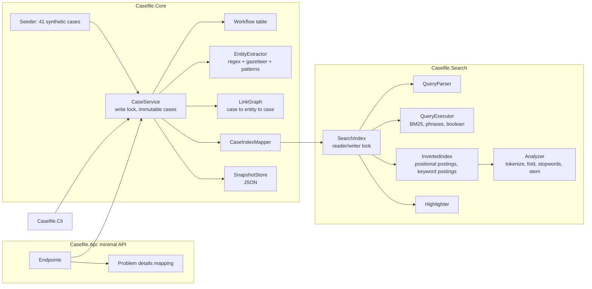

# casefile-dotnet

Case management for analysts with a search engine written from scratch: BM25 ranking, faceted filtering, entity extraction and link analysis between cases, served through an ASP.NET Core minimal API.


## What it demonstrates

- An inverted index with positional postings and Okapi BM25 scoring (per-field boosts, length normalization), with phrase queries that respect stopword gaps and never match across values of a multi-valued field.
- An analyzer pipeline for mixed English and Italian text: tokenizer with character offsets, lowercasing, accent folding, EN/IT stopwords, a light stemmer. Highlighted snippets wrap the original surface form ("Società") even though matching happens on the folded, stemmed term.
- A recursive descent query parser (`AND`/`OR`/`NOT`, `-term`, parentheses, quoted phrases, `field:value`) and multi-select facets (a field's counts ignore that field's own filter).
- Hybrid entity extraction: regular expressions for identifiers (email, international phone, account numbers validated with the mod-97 checksum), a token-trie gazetteer with longest match and alias folding, and pattern rules for unknown people and organisations.
- A case/entity link graph with a "related cases" query ranked by IDF-weighted shared entities, type factors and a hub cut-off.
- A status workflow (Open, InReview, Closed) as an explicit transition table with guards (four-eyes close, report required, reason required), an audit trail, optimistic concurrency and RFC 7807 problem responses carrying the violated rule code.
- Thread-safe incremental indexing, JSON snapshot persistence with the index and graph rebuilt on load, and a zero-dependency test runner with an end-to-end test over real HTTP.

## Architecture



`Casefile.Search` is a generic library: it knows text fields, keyword fields and documents, nothing about cases. `Casefile.Core` owns the domain and is the only place that maps a case onto an index document (`CaseIndexMapper`). The search index and the link graph are derived data: every write in `CaseService` replaces one immutable `Case`, then upserts that single document into the index and resets that case's edges in the graph. The snapshot stores only cases; on load both derived structures are rebuilt. The API and the CLI are thin shells over `CaseService`.

## Quickstart

Requires the .NET 8 SDK. There are no package dependencies; `nuget.config` clears package sources so restore works offline.

```bash
export DOTNET_CLI_TELEMETRY_OPTOUT=1 DOTNET_NOLOGO=1

dotnet build
dotnet run --project tests/Casefile.Tests            # 48 tests, non-zero exit on failure
dotnet run --project tests/Casefile.Tests -- Bm25    # run only tests whose name contains "Bm25"

# CLI demo over the seeded corpus
dotnet run --project src/Casefile.Cli -- search "wire transfer AND status:Open"
dotnet run --project src/Casefile.Cli -- search '"bonifici ripetuti" OR societa' --limit 3
dotnet run --project src/Casefile.Cli -- related CF-0027
dotnet run --project src/Casefile.Cli -- stats

# API (seeds 41 cases on first start, saves a snapshot to src/Casefile.Api/data/ on shutdown)
dotnet run --project src/Casefile.Api
```

Example calls (the actor comes from the `X-Actor` header; a real deployment would use an authenticated principal):

```bash
curl -s localhost:5080/search -H 'content-type: application/json' \
  -d '{"query":"\"wire transfers\" -tag:structuring","filters":{"status":["Open","InReview"]},"facets":["status","tag","etype"]}'
curl -s localhost:5080/cases/CF-0001/related
curl -s localhost:5080/entities/Phone/+447700900417/cases
curl -s -X POST localhost:5080/cases/CF-0001/transitions -H 'X-Actor: lead.conti' \
  -H 'content-type: application/json' -d '{"to":"InReview"}'
```

Endpoints: `GET/POST /cases`, `GET/PATCH/DELETE /cases/{id}`, `POST /cases/{id}/documents`, `DELETE /cases/{id}/documents/{docId}`, `GET/POST /cases/{id}/transitions`, `GET /cases/{id}/audit`, `GET /cases/{id}/related`, `POST /search`, `GET /entities/{type}/{key}/cases`, `POST /extract`, `POST /admin/snapshot`, `GET /health`.

Query fields: text `title` (boost 2.0), `summary` (1.2), `body` (1.0); keyword `status`, `tag`, `priority`, `assignee`, `etype`, `entity`.

## Design decisions

1. **Keyword clauses filter but do not score.**
   Why: `status:Open` is a constraint, not evidence of relevance. If it contributed BM25 weight, adding a filter would reorder results, which analysts read as the engine changing its mind.
   Trade-off: a keyword match cannot be used to boost (for example "prefer High priority"); that would need an explicit boost syntax.

2. **Positions survive stopword removal, and multi-valued fields get a position gap.**
   Why: "bank of genoa" must not match "bank genoa", and a phrase must not straddle two separate notes attached to the same case. Keeping original positions and adding a gap of 100 between values handles both with the same positional check.
   Trade-off: slightly larger position numbers and a fixed gap constant; a phrase longer than the gap could in theory bridge values (not a realistic query).

3. **Identifiers outrank names in link analysis, and hubs are cut.**
   Why: two cases sharing an account number are far more likely to be connected than two cases mentioning the same city. Each shared entity contributes `ln(1 + N/df)` (rarity) times a type factor (account 1.5, phone and email 1.3, names 1.0, locations 0.4). Entities present in more than 25% of cases are ignored, which removes noise links and bounds the two-hop walk.
   Trade-off: the factors are hand-set rather than learned from confirmed links, and a genuinely important hub (a known front company everyone uses) is silenced; it remains findable through `/entities/{type}/{key}/cases`.

4. **Immutable cases, one writer lock, derived structures with their own reader/writer locks.**
   Why: requests that read cases never block; writes are rare compared to searches, so serializing them is cheap and removes a whole class of index and graph consistency bugs. Each write updates one document incrementally, so changes are searchable on the next request with no refresh cycle.
   Trade-off: the index and the case store are updated in sequence, not atomically, so a concurrent search can briefly see an index entry for a case version that was just replaced. The search path re-reads cases from the current store, so it never returns a deleted case.

5. **Persist only the domain; rebuild the index on load.**
   Why: the snapshot format is then independent of index internals, which can change freely (new analyzer, new fields) without a migration. Rebuilding 41 cases takes milliseconds, and saves are atomic (temp file plus move).
   Trade-off: start-up time grows linearly with corpus size; at scale one would persist index segments and an append-only change log.

6. **A hand-written test runner instead of a test framework.**
   Why: package feeds are unreachable in the build environment, and the repo is constrained to the base class library and the ASP.NET Core shared framework. The runner discovers `[Test]` methods by reflection, awaits async tests with a timeout, disposes fixtures, supports a name filter and returns a non-zero exit code on failure, which is all CI needs. The end-to-end test hosts the real app on port 0 and calls it with `HttpClient`.
   Trade-off: no IDE integration, parallel execution or data-driven tests. In a team setting I would use a standard test framework and its test host.

## Scope and limits

- In-memory index sized for thousands of cases, not millions: no segment files, merges or memory mapping.
- Entity extraction is rule and dictionary based; no statistical model, no coreference ("he", "the company"), no entity resolution beyond normalized keys and aliases.
- The stemmer is a light suffix stripper shared by English and Italian, not a language-specific algorithm; it over-stems some words consistently on both index and query side.
- No authentication or authorization; the actor is taken from a header to make the audit trail and the four-eyes rule demonstrable.
- No fuzzy matching, synonyms or spelling correction.
- All data is synthetic: invented names, `.example` email domains, phone numbers from ranges reserved for fiction, generated account numbers with valid checksums over made-up bank codes.

## About this lab

A compact reference implementation written in 2026. It reconstructs, on synthetic data, patterns I have used in production systems (full-text ranking, entity extraction and link analysis for investigative case work), without reproducing any proprietary design.

## License

MIT, see [LICENSE](LICENSE).
